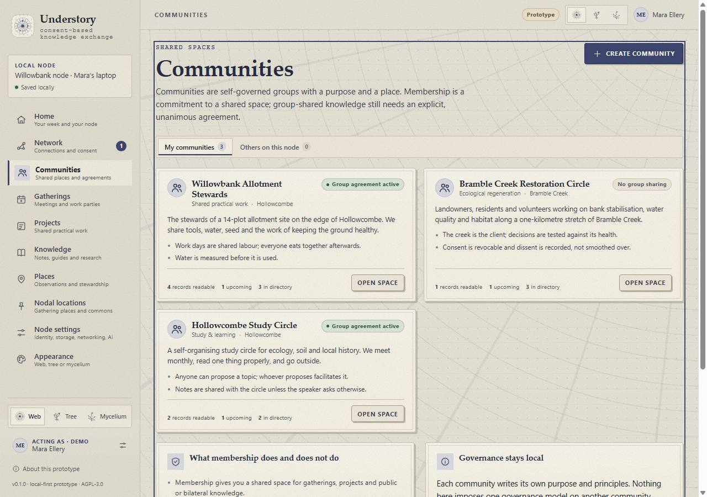
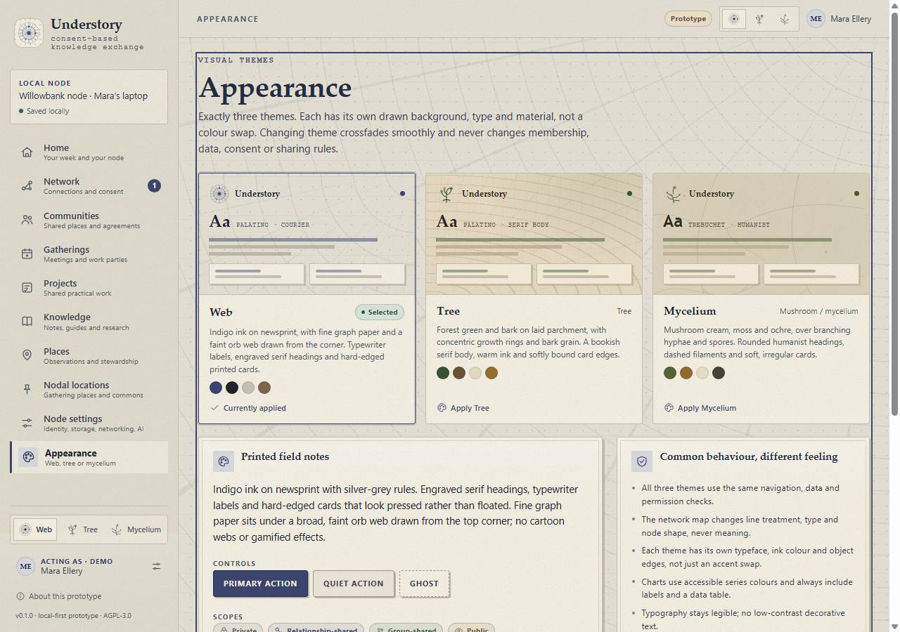
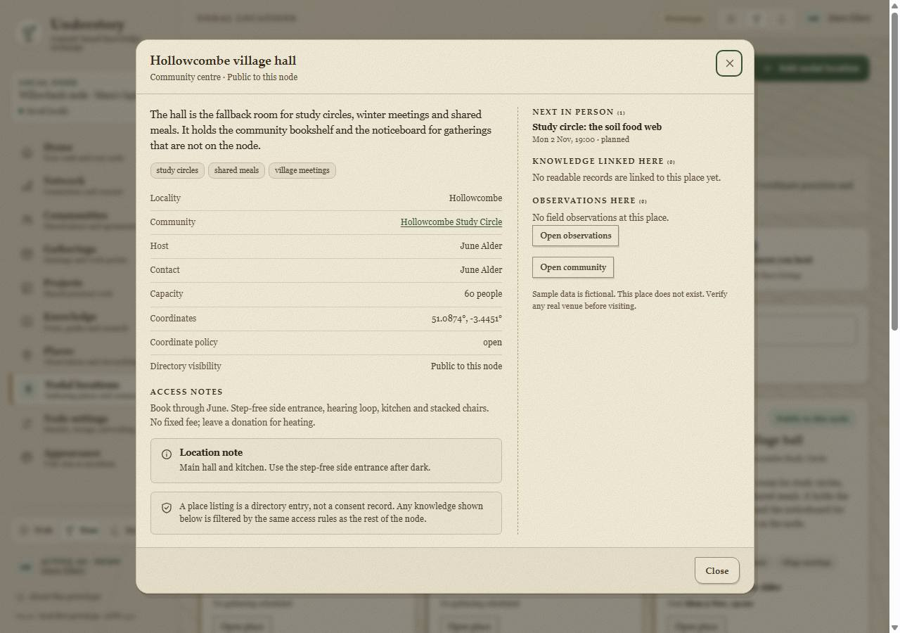

# Accessibility audit

**Date:** 21 October 2026
**Target:** WCAG 2.2 level AA for the interface, plus a review against common best
practice for single-page apps.
**Build:** the local prototype served by `npm run dev`, with the Web, Tree and
Mycelium themes.

This is an engineering audit, not a certification. It combines automated checks,
rendered-pixel measurements and scripted keyboard probes. It does not replace a
manual screen-reader pass, which remains outstanding (see
[Remaining limits](#remaining-limits)).

## Method

| Layer | What it does | Tooling |
| --- | --- | --- |
| Rule scan | Full axe-core 4.10.2 rule set (WCAG 2.0/2.1/2.2 A-AA and best practice) on 16 routes × 3 themes, desktop 1280×900 and mobile 390×844 | `.tooling/a11y-audit.mjs` |
| Rendered contrast | Screenshots the real page, samples the pixels inside every text box, compares the dominant surface with the computed text colour | `.tooling/a11y-contrast.mjs` |
| Token matrix | Recomputes 30 text/background pairings per theme straight from `src/styles/app.css` | `.tooling/a11y-tokens.mjs` |
| Interaction probes | Skip link, tab order, focus rings, radio groups, tabs, target sizes, 320 px reflow, 200 % zoom, reduced motion | `.tooling/a11y-probe*.mjs` |
| Dialog isolation | Portal placement, `inert` background, hit-testing, Tab/Shift+Tab containment, Escape, focus restore, release of `inert` and scroll lock | `.tooling/probe-inert.mjs` |

The pixel layer exists because axe reports the themed surfaces as *incomplete*:
every theme is drawn with a grain overlay (`body::after`, `mix-blend-mode:
multiply`) and per-theme textures, so axe cannot resolve a background colour for
6,006 text nodes. Those are exactly the nodes that matter for the theme work, so
they are measured from the rendered frame instead. Text is measured against the
brightest common pixel cluster for dark text (and the darkest for light text) to
avoid mistaking glyph antialiasing for the surface.

## Results after the fixes

| Check | Result |
| --- | --- |
| axe-core page audits | **63 audits, 0 violations** (2,619 rule passes) |
| Rendered contrast | **36 page/theme combinations, 2,685 text boxes, 0 below threshold** |
| Token matrix | **90 pairings (30 × 3 themes), 0 below 4.5:1** |
| Reflow | 0 px horizontal overflow at 320 px and at 640 px (≈200 % zoom) |
| Target sizes | Smallest interactive target is now 24 × 24 px |
| Modal isolation | Dialog portalled to `<body>`, `#root` inert while open, focus trapped and restored, pure background removed from the accessibility tree |
| Reduced motion | Theme changes apply without the crossfade; no animation is required |
| Keyboard | Every control reachable and visibly focused; graph nodes take focus with a 2.6 px ink outline |

The twelve measured theme pairs that carry most of the small text:

| Pair | Web | Tree | Mycelium |
| --- | --- | --- | --- |
| micro-copy (`--faint`) on the darkest surface | 4.68:1 | 4.96:1 | 4.77:1 |
| muted text on the darkest surface | 5.07:1 | 5.13:1 | 5.14:1 |
| sample badge (gold mixed with ink) | 6.25:1 | 5.38:1 | 5.43:1 |
| public scope badge on its tint | 5.44:1 | 5.57:1 | 5.50:1 |
| warning badge | 4.82:1 | 5.55:1 | 5.25:1 |
| primary button label | 8.42:1 | 7.72:1 | 7.07:1 |

## What was wrong, and what changed

### 1. Contrast of small text (WCAG 1.4.3)

The material layer was the cause of most failures: token colours were chosen
against flat surfaces, then the grain and per-theme textures darkened the
rendered background by a few percent. Measured failures before the fix:

- micro-copy (`--faint`) at **2.6–3.7:1** in every theme (stat hints, meta rows,
  chips, sidebar footer, version line);
- the "Prototype"/"Sample" badge at **3.1–3.8:1** (raw gold on gold-soft);
- public and community scope badges at **3.4–4.3:1**, worst in Tree;
- muted text on the darkest textured surface at **4.0–4.4:1**;
- warning badges at **4.1–4.3:1** in Tree and Mycelium.

Fixes: `--faint` and `--muted` were darkened per theme and now target roughly
5:1 against `--surface-3` so the overlay cannot push them under 4.5:1;
`.badge-sample` uses `color-mix(in srgb, var(--gold) 62%, var(--ink))`;
`--scope-public`, `--scope-community`, `--scope-private` and `--warning` were
darkened in the themes that failed. The palette, hue and material character are
unchanged, and no layout metric changed.

`--faint` now sits close to `--muted` in lightness by design: hierarchy in
micro-copy comes from size and weight, not from low contrast.

### 2. Heading order (WCAG 1.3.1, 2.4.6)

List cards jumped from the page `h1` straight to `h3`, and the detail pages
jumped from a card `h2` to `h4`. Card titles on Communities, Projects, Places
and Nodal locations are now `h2`; agreement titles, place-card titles and the
mini-headings inside cards are `h3`. The map from level to visual size is kept
in CSS with `:is()` selectors, so nothing moved visually.

### 3. Skip link sent people to Home (WCAG 2.4.1)

`href="#main"` is also the router's hash. Activating the skip link changed the
hash to `#main`, which the router parsed as an unknown route and rendered Home.
The link now prevents the default and moves focus to `<main id="main">`, so the
current page and route are preserved.

### 4. Static document title (WCAG 2.4.2)

Every route shared the landing-page title. Titles now follow the route
("Network · Understory", "Node settings · Understory", …).

### 5. Focus stayed behind on navigation (WCAG 2.4.3)

After an in-app route change, focus remained on the nav link that was clicked, so
the next Tab walked the old navigation. Route changes now move focus to the main
region (`tabIndex={-1}`, no scroll jump). The skip link and route focus share the
same target.

### 6. Theme pickers were three tab stops with no arrow keys (WCAG 4.1.2, ARIA APG)

Both `role="radiogroup"` pickers (sidebar and Appearance) now use a roving
tabindex, with Arrow keys, Home and End changing the selection and moving focus.
The Appearance cards also lost an `h2` that was nested inside a `<button>`.

### 7. Tabs claimed a tab pattern they did not implement (WCAG 4.1.2)

The filter bars used `role="tablist"`/`role="tab"` with no tabpanels, no
`aria-controls` and no arrow-key support. They filter one view in place, so they
are now a labelled `role="group"` of buttons with `aria-pressed`.

### 8. `aria-label` on elements without a role (WCAG 4.1.2)

The nav count, zoom readout, graph legend and Appearance palette carried
`aria-label` on generic `span`/`div` elements, where the name is not exposed.
The nav count and zoom readout now use visually hidden text, the legend and tag
filter are `role="group"`, and the palette swatches are decorative
(`aria-hidden`).

### 9. Icon-only scope badges had no name (WCAG 1.1.1)

`<ScopeBadge short />` renders only an icon, and the icon is hidden from
assistive tech. The label is now present as visually hidden text.

### 10. Duplicate complementary landmarks (best practice)

The nodal detail page had two unlabelled `<aside>` landmarks. Both now carry
labels ("Node sidebar", "Schedule and access notes").

### 11. Small targets (WCAG 2.5.8)

Hide-notice, footer links, "all …" links and the toast dismiss button were
15–23 px tall. They now have a 24 px minimum target box.

### 12. Hints were not associated with fields (WCAG 3.3.2)

`Field` renders hints and errors under the control. It now assigns ids and wires
`aria-describedby`/`aria-invalid` onto plain input, select and textarea children.

### 13. Timed status messages (WCAG 2.2.1)

Notices disappeared after 5.2 s. Errors no longer auto-dismiss, and other
messages stay for 8 s and remain dismissible.

### 14. The page behind a dialog stayed in the accessibility tree (WCAG 1.3.1, 2.4.3, ARIA APG dialog pattern)

`Modal` set `aria-modal="true"` and trapped Tab, but the dialog was rendered
inside `#root` and the rest of the app was untouched: assistive technology that
does not act on `aria-modal` could still read and reach the page behind it.

The dialog is now rendered into a portal on `<body>`, so it sits outside the app
subtree, and `#root` carries the `inert` attribute while any dialog is open. That
removes the background from the accessibility tree, from the tab order and from
pointer hit-testing in one step, and the inertness is released when the last
dialog closes.

Supporting changes in the same component:

- a dialog stack, so a confirm opened from inside another dialog owns Tab and
  Escape instead of closing both layers;
- counters for the `inert` flag and the body scroll lock, so stacked dialogs
  restore the page exactly once;
- `onClose` is held in a ref, so a parent re-render no longer tears the effect
  down and bounces focus back to the first field mid-form;
- the focus timer is cleared on close, and focus falls back to the main region
  when the trigger has been removed while the dialog was open;
- the toast live region moved to its own portal, so a status message raised from
  a dialog is still announced while the app is inert.

## Additions after the main run

Knowledge attachments, the voice recorder and transcripts were added after the
63-audit matrix. They were checked separately on the same day with axe-core
(WCAG 2.0/2.1/2.2 A-AA plus best practice) over the record detail page and the
open editor: 0 violations. The file picker is labelled through its fieldset and
hint, the record, stop and discard buttons are ordinary keyboard-operable
buttons with a live status line, and the transcript uses native `<details>`. The
rendered-pixel sampler was not rerun for these surfaces; their text uses the
already-measured `--ink`, `--ink-soft` and `--muted` tokens on `--surface`.

## Remaining limits

- **No screen-reader session.** The audit used axe, the accessibility tree,
  focus and keyboard probes. A pass with NVDA/Firefox and VoiceOver/Safari is
  still needed, particularly for the network map and the consent dialog.
- **`title`-only explanations.** A few badges (for example the Prototype badge
  and the coordinate-policy badge) explain themselves only through `title`,
  which keyboard and touch users cannot reveal. Visible or `aria-describedby`
  text would be better.
- **The network map has no textual adjacency alternative.** Nodes are keyboard
  focusable with names and actions, but there is no table of connections
  parallel to the chart's data table.
- **Chart axis labels** are SVG text and are excluded from the pixel sampler
  (the mode there can be a chart line). They use the audited `--faint` and
  `--axis` colours, but are not measured individually.
- **`inert` is a modern-browser feature.** Chromium 102+, Firefox 112+ and
  Safari 15.5+ honour it. Older engines fall back to `aria-modal` plus the focus
  trap, which is what the app relied on before.
- **Stacked dialogs are handled but not exercised.** The stack, counters and
  single-owner keyboard handling are in place, but no current flow opens a
  second dialog from inside a first one, so that layering has no scripted probe.
- **The grain overlay is a permanent constraint.** New colours must be checked
  against rendered pixels, not only against token pairs.
- **No CI gate.** The harness needs a running dev server and a Chromium instance
  with remote debugging. It is deliberately kept out of `package.json` and the
  production bundle.

## Reproducing

```bash
npm run dev                      # http://127.0.0.1:5178
# start Chromium with --remote-debugging-port=9222

node .tooling/a11y-audit.mjs      # axe, all routes × themes × viewports
node .tooling/a11y-contrast.mjs   # rendered-pixel contrast
node .tooling/a11y-tokens.mjs     # token matrix per theme
node .tooling/a11y-probe2.mjs     # skip link, titles, focus, radios, reflow
node .tooling/probe-inert.mjs     # modal portal, inert background, trap, restore
```

Results are written next to the scripts as `a11y-results.json`,
`a11y-contrast-results.json` and `a11y-probe2-results.json`.
`probe-inert.mjs` prints 16 checks (including navigation out of a dialog) and
exits non-zero on failure. The scripts
assume the sample data and open a fresh tab per run; they do not modify node data.

## Visual check




